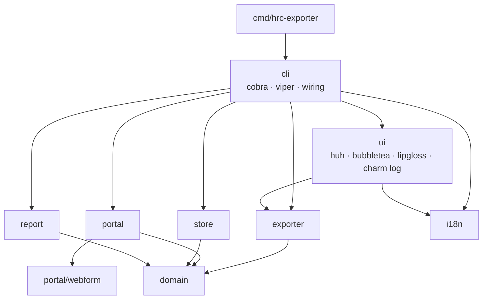
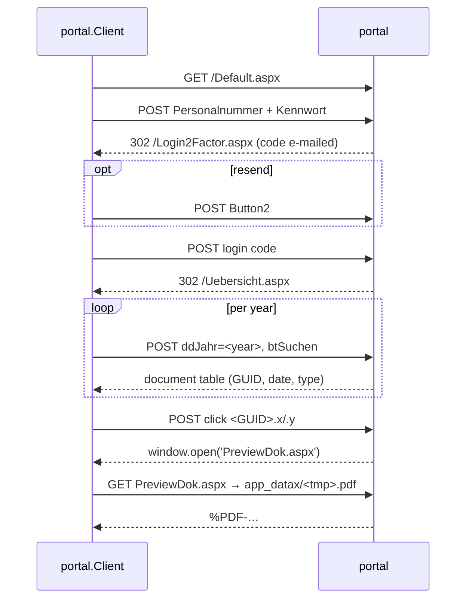

# Architecture

## Packages



All packages live under `internal/`.

| Package | Role |
| --- | --- |
| `domain` | `Document`, `Record`, `Credentials`, sentinel errors |
| `portal/webform` | Parses ASP.NET pages: hidden fields, selects, tables, `window.open`/`alert` scripts |
| `portal` | Stateful HTTP client: login, 2FA, list, download |
| `store` | Versioned `meta.json`, atomic writes |
| `exporter` | Use cases `Authenticate`, `Status`, `Sync`; declares the ports |
| `report` | Payslip parsing and analysis, HTML/JSON rendering |
| `i18n` | Typed message keys, en/de catalogs, language detection |
| `ui` | Prompts, progress view, plain log output, tables, translated errors |
| `cli` | Commands, config, language resolution; the only place that wires concrete types |

Core packages: `domain`, `portal`, `store`, `exporter` and `report`. Presentation packages: `ui` and `cli`.

## Rules

1. Core does no terminal I/O. It imports no cobra, viper or charm packages, and none of `ui`, `cli` or `i18n`.
   `internal/archtest` enforces this (`just check-deps`).
2. Core logs through an injected `*slog.Logger` and reports progress as `exporter.Event`s. It returns results as values,
   and `ui` formats them.
3. Interfaces are declared by the package that uses them:
   - `exporter/ports.go`: `Portal`, `Store`, `Authenticator`, `Reporter`, `FileSystem`;
   - `report`: `Records`, `TextExtractor`.

   The concrete types satisfy them implicitly.
4. Core messages are English. Only `ui` and `cli` translate.

## Portal protocol

HRCommunicator is an ASP.NET WebForms app without an API. Every action is a form POST to the current page and must
echo its hidden state (`__VIEWSTATE`, `__EVENTVALIDATION`, …). The session lives in cookies. Redirects are followed
manually because `302` signals success.



- The client is stateful and not safe for concurrent use.
- The portal only accepts a document click while that document's year is listed. `Download` re-lists the year if needed.
- The GUID is the stable document ID. File names under `app_datax/` are temporary.
- A rejected login or code comes back as `200` and becomes `ErrInvalidCredentials` or `ErrInvalidCode`, plus any
  `alert()` text. A redirect to `Default.aspx` becomes `ErrSessionExpired`.

## `download`

1. `cli` resolves the config and builds the client, store, prompter and exporter (`cli/wire.go`). If no portal URL is
   configured, `ui.Prompter` asks for it.
2. `exporter.Authenticate` prompts for credentials and the login code, with up to 3 attempts at the code. An empty code
   requests a new one. After a successful login, `cli` caches the personnel number and portal URL in the user cache
   dir (`cli/lastused.go`) as prompt defaults.
3. `exporter.Sync` runs inside `ui.RunProgress` (bubbletea).
   - A document is skipped when the store has its record and the file still exists.
   - Each file is written to a `.part` temp file while its SHA-256 is computed, then renamed into place. The store is
     saved after every file.
   - A failure of one document is recorded in `Summary.Failures` and the run continues.
4. `ui.Renderer.Summary` prints the result. The session logs out even if the run was cancelled.

Without a terminal, or with `--plain`, prompts and progress fall back to plain line output.

## `report`

1. `cli` opens the store and locates `pdftotext`.
2. `report.Generate` extracts the text of every `Entgeltabrechnung` record with `pdftotext -raw`. A record whose file is
   missing is skipped with a warning. Extraction and parse errors abort the run.
3. `ParsePayslip` reads one page block per period. The first block is the payslip's own month. Every further block is
   a retroactive recalculation that carries differences. Wage rows are classified by name prefix (`wagetype.go`), and
   the rows flagged G must add up to Gesamtbrutto.
4. `Build` keeps one `Month` per period. If two payslips cover the same month, the one printed later wins. `Build`
   applies the retro differences to the months they belong to, then derives:
   - salary `Event`s (group, step, tariff, ÜT) with the amount offset against the ÜT;
   - yearly totals, the tariff table and the `Summary`.
5. `WriteHTML` renders the embedded `report.html.tmpl`, a single page with inline SVG charts. `WriteJSON` writes the
   chart series. `cli` writes both files atomically.

The HTML is German, like the payslips. Parser warnings are English and are logged by `cli`.

## `meta.json`

```json
{
  "version": 1,
  "documents": {
    "<guid>": { "id": "…", "year": 2025, "date": "2025-12-01", "type": "Entgeltabrechnung",
                "file": "2025/2025-12-01_entgeltabrechnung_aaaaaaaa.pdf",
                "sha256": "…", "size": 12345, "downloaded_at": "2026-01-01T00:00:00Z" }
  }
}
```

- A missing or newer `version` fails with `ErrUnsupportedVersion`. When the schema changes, bump `store.Version` and
  migrate in `store.Open`.
- The JSON types are private to `store`. Output is deterministic and written atomically.
- `file` is slash-separated and relative to `<out>`. The layout comes from `exporter.RelativePath`.

## i18n

- Message keys are constants in `keys.go`. Each language has a catalog file (`catalog_en.go`, `catalog_de.go`).
  An `i18n.Printer` is injected wherever text is produced; there is no global state.
- Language: `--lang`, then `HRCE_LANG`, then the config file, then the system language (Windows UI languages or
  `LC_ALL`/`LC_MESSAGES`/`LANG`), then English. `--lang` is resolved before the commands are built, so `--help` is
  translated as well.
- `ui.ErrorText` translates known sentinel errors and keeps their context.
- `cli.localizeCobra` translates cobra's usage template and its help/completion texts.
- `catalog_test.go` fails if a catalog is missing a key, has an extra key, or has placeholders that differ from English.
- To add a language: add a `Lang` constant, a `catalog_xx.go` file and an entry in `catalogs` (`catalog.go`).

## Tests

| Package | Covers |
| --- | --- |
| `portal/webform` | Parsing of HTML snippets modelled on the real pages |
| `portal` | Full protocol against an `httptest` fake portal |
| `store` | Round trip, version check |
| `exporter` | Use cases with fakes and a temp dir: skip, re-fetch, failures, dry run |
| `report` | Parser, retro corrections, offsets, duplicates, `Generate` with a fake extractor, rendering, pdftotext lookup |
| `i18n` | Catalog completeness and placeholder parity, detection, plurals |
| `ui` | Summary rendering, translated errors |
| `cli` | Flag/env binding, language resolution, translated help |
| `archtest` | Core has no presentation dependencies |
